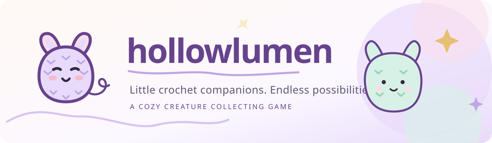

# Hollowlumen — Crochet Creature World

*Provisional branding: [Lavender & Loop brand kit](docs/BRAND_PROTOTYPE.md).*

**Status:** Concept and specification draft; **no runnable prototype yet**.  
**Title:** Working title (*Lumenette Hollow* appeared in the original pitch).

> Make little living crochet creatures. Discover more complex patterns, grow a collection of unique critters, care for them, and choose a favorite to live on your phone.

## What we're making

A cozy **Tamagotchi-like creature collection game** set in a whimsical crochet world.

- **Patterns** determine what kinds of crochet critters can be made. Finding more advanced patterns opens up new shapes and possibilities.
- **Critters** are individual companions. Two made from the same pattern can look or behave differently and remain independently collectible.
- **Companionship** is central: interact with, name, enjoy, and favor a critter.
- **Phone favorite:** the selected critter should live in a home-screen widget, subject to actual Android/iOS integration.
- **Possible later depth:** inherited traits, breeding for particular strains, and much later Spore-like complexity. These are design ideas, **not current commitments**.

The small first experiment is to create, collect, name, pet, and favorite a few differently patterned critters, with local save/load and a widget-style mock display. Actual phone widget integration is an early required product proof, but not something the mock can claim to implement.

**Not the established prototype core:** cottage decoration, idle farming, shop/VIP packs, battery-charge bonuses, or online multiplayer. A **separate draft RPG expansion** now explores quests, battles, and one of three free starter patterns; these remain unapproved proposals, not implemented features.

## Documents

- [Working product specification](docs/PRODUCT_SPEC.md): core loop, pattern/individual distinction, prospective genetics, widget, tiny checkpoints and open decisions.
- [Gameplay loops and RPG expansion](docs/GAMEPLAY_EXPANSION.md): starter patterns, adventure, combat, progression, possible monetization, modular boundaries and reviewable milestones.
- [Zero-sacred-cows concept review](docs/CONCEPT_DEMOLITION_REVIEW.md): critical comparison of the RPG conventions with a material-driven Threadwork alternative, originality/IP questions and tiny falsifiable prototypes.
- [Client review and acceptance plan](docs/CLIENT_REVIEW.md): unapproved product decisions, neutral playtests, evidence collection and acceptance gates.
- [Lavender & Loop design language](docs/DESIGN_LANGUAGE.md): proposed pastel-purple palette, amigurumi art grammar, screen styling, type, widget presentation, and accessibility.
- [Prototype brand kit](docs/BRAND_PROTOTYPE.md): editable SVG mascot mark, wordmark, app-icon candidate, hero banner, and usage guidance.
- [Original README source audit](docs/SOURCE_AUDIT.md): what was described and why the prior "playable prototype" claim is not supported.
- [Original concept pitch at the initial revision](https://github.com/cosmicdance-4-2-0/hollowlumen/blob/ac0317e250bef11c1f12abebe7be023aa41ecb47/README.md).

## Development state

There is no application source or package manifest in this repository yet; no install, development-server, or build instructions can honestly be provided. This repository currently contains **proposed documentation and prototype brand art only**. Before writing substantial code, resolve visual direction and the primary native widget platform.

**License:** Not selected. The absence of a license is not a license to redistribute source, art or assets.
