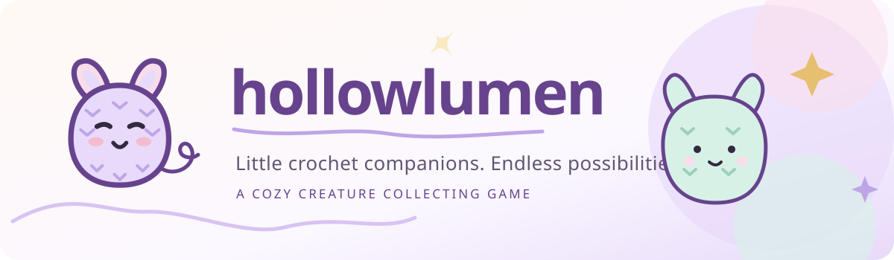
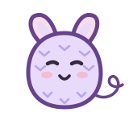
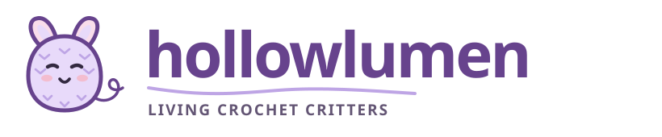
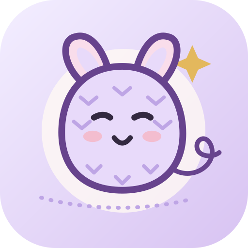

# Hollowlumen — Prototype Brand Kit

**Version:** 0.1.0-draft  
**Status:** Experimental, original vector artwork; not final identity or trademark-cleared  
**Design system:** [Lavender & Loop](DESIGN_LANGUAGE.md)  
**Product:** [Crochet creature collection concept](PRODUCT_SPEC.md)  
**Date:** 2026-11-05

## Brand intent

**Hollowlumen** is a *working name*. These initial assets make the current concept tangible without deciding the title, release platform, final typeface or creature taxonomy. The emblem is a friendly, purple, crocheted critter with stitched V details, a yarn-thread curl and subtle rosy cheeks. It suggests collectible handmade companions rather than shops, cottages or resource farming.

**Voice:** soft, curious, approachable. The system should remain recognizable on a phone and restrained enough not to eclipse the actual critters.

### Hero banner (README)

### Primary emblem

### Wordmark

### App icon candidate

## Asset inventory

| Asset | Use | Status |
| --- | --- | --- |
| [`hollowlumen-mark.svg`](../assets/brand/hollowlumen-mark.svg) | Small identity symbol, simple stickers, standalone logo | Prototype |
| [`hollowlumen-wordmark.svg`](../assets/brand/hollowlumen-wordmark.svg) | Page header, mock splash screen, title lockup | Prototype |
| [`hollowlumen-app-icon.svg`](../assets/brand/hollowlumen-app-icon.svg) | App launcher icon concept / platform icon exploration | Prototype; not platform-ready |
| [`hollowlumen-banner.svg`](../assets/brand/hollowlumen-banner.svg) | GitHub README / planning-board banner | Prototype |

All assets are editable vector SVG with explicit fills and strokes, no external images, no embedded fonts, no scripts, and descriptive title/description text.

## Geometry and usage

- **Core motif:** loop-eared critter with a stitched smile, yarn curl and V-stitch markings. The mark is a stylized icon, not the final in-game species model or a crochet pattern.
- **Colors:** lavender `#E8DAFA`, deep action purple `#67438D`, plum `#332940`, blush `#F9DDEB`, and warm ivory `#FFF9F4`. Other pastel yarn colors belong in creatures and accents; the mark is intentionally simple.
- **Clear space:** prototype recommendation of at least **¼ of the visible emblem width** from surrounding labels or controls. Confirm after testing on actual layouts.
- **Small size:** below roughly **32 logical pixels**, the fine V-stitch details will soften. Prefer the simple emblem over the complete wordmark, and evaluate a dedicated reduced-detail glyph before shipping a real favicon.
- **Wordmark:** uses a **font fallback stack** (`ui-rounded`, Trebuchet MS, Arial Rounded MT Bold, system UI). Text appearance therefore varies by environment. **Convert final approved lettering to vector paths or ship a properly licensed bundled font** before claiming a fixed official logotype.
- **Do not:** stretch either dimension independently; put plum text over saturated/dark purple; add misleading badge/status text; imply the app is shipped; use this identity to promise native-widget functionality that has not been built.
- **Raster exports:** none committed. When platform targets are selected, export/review Android/iOS icon masks, light/dark/tinted variants and legibility at real device pixel sizes.
- **Dark mode:** not specified here; future variants must be designed and checked on actual widget backgrounds, not assumed from these light-mode assets.

## Implementation boundary

These are **brand concept assets, not executable application code**. They need not dictate whether in-game critters are rendered in SVG, 2D sprites, or 3D. Reuse the approved semantic palette and form-language in whichever renderer the product selects.

The emblem's critter may eventually be named or replaced. The world should support many visually different critters, not an endless repetition of the mascot.

## Review gate

Before approving the brand:
1. Show the hero, wordmark and icon to the actual product owner; confirm whether the mood fits.
2. Test the mark at approximately 32, 64, 128 and 256 px and on contrasting light/tinted surfaces.
3. Inspect the SVGs for valid XML, viewBox, asset independence, legibility and unwanted external references.
4. Confirm the final player-facing name and lettering before investing in production exports.
5. Record asset provenance and select an appropriate license before public reuse.

**Current evidence:** assets have been committed to a draft documentation/branding PR. No application, native widget, device preview, trademark clearance, font licensing audit, or user acceptance trial is claimed.
